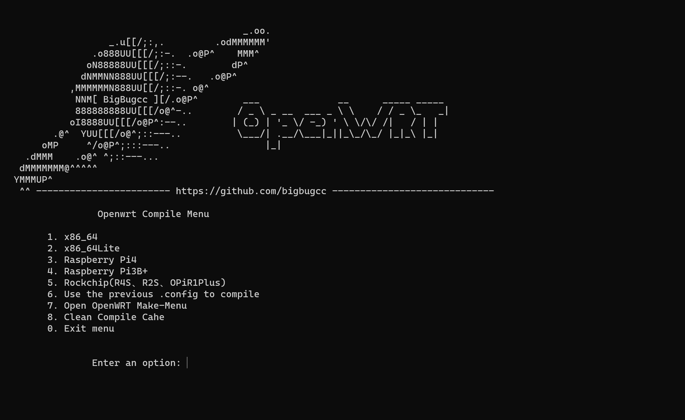

# OpenWrt Auto-Build Script

**[中文文档](./README.zh-CN.md)**

A local automated build tool for [Lean's LEDE](https://github.com/coolsnowwolf/lede) OpenWrt firmware. Configuration files are sourced from [bigbugcc/OpenWrts](https://github.com/bigbugcc/OpenWrts/tree/main/configs).

## Features

- Automatically installs all build dependencies
- Automatically clones the LEDE source code
- Automatically adds popular plugins (PassWall2, OpenClash, iStore, etc.)
- Automatically syncs upstream config files for multiple platforms
- Interactive menu for one-click multi-platform firmware builds
- Built-in `make.sh` management script that auto-updates sources and plugins on every run

---

## Console Preview



---

## Getting Started

> ⚠️ Do NOT run as root!

```bash
sudo mkdir -p /workdir && cd /workdir

# Set directory ownership
sudo chown $USER:$GROUPS /workdir

# Grant execute permission and run
chmod +x ./openwrtinstall.sh
./openwrtinstall.sh

# Subsequent builds — run directly from the lede directory
./make.sh
```

---

## Build Menu

| Option | Description |
|:------:|-------------|
| 1 | x86_64 |
| 2 | Raspberry Pi 5 |
| 3 | Raspberry Pi 4 |
| 4 | Raspberry Pi 3B+ |
| 5 | Rockchip (R68S, R2S, R4S, R5C, R5S, OPiR1Plus) |
| 6 | Build using existing .config |
| 7 | Open OpenWrt config menu (make menuconfig) |
| 8 | Clean build cache |
| 0 | Exit |

---

## Supported Platforms

| Platform | Notes |
|----------|-------|
| x86_64 | Standard / Lite edition |
| Raspberry Pi 3B/3B+ | RPi 3 series |
| Raspberry Pi 4B | RPi 4 series |
| Raspberry Pi 5 | RPi 5 series |
| NanoPi R2S / R4S | FriendlyARM |
| NanoPi R5C / R5S | FriendlyARM |
| FastRhino R68S | |
| Orange Pi R1 Plus | |

### Default Firmware Settings

| Item | Value |
|------|-------|
| Router IP | `192.168.10.1` |
| Username | `root` |
| Password | `password` |

---

## Built-in Plugins

**Proxy / VPN**
- PassWall2
- SSR Plus
- OpenClash
- Hello World

**Ad Blocking**
- AdGuard Home
- luci-adbyby-plus

**Utilities**
- luci-app-unblockmusic — Unblock NetEase Music
- luci-app-pushbot — Multi-channel push notifications
- luci-app-ddns
- luci-app-onliner
- luci-app-ttyd — Web terminal
- luci-app-turboacc — Traffic acceleration
- luci-app-upnp
- luci-app-netdata
- luci-usb-printer
- luci-app-nps — NPS intranet tunnel
- luci-app-frpc — FRP client
- luci-app-n2n
- luci-app-syncdial — Multi-dial
- luci-app-kms
- luci-app-docker
- luci-app-serverchan
- luci-app-control-timewol — Scheduled WOL wake-up
- luci-app-aliyundrive-webdav — Aliyun Drive WebDAV
- OpenAppFilter — Application filter
- Mentohust — 802.1X authentication
- iStore — App store

---

## Incremental Builds

Run `make.sh` inside the `lede/` directory. It will automatically pull the latest LEDE source and update all plugins before launching the build menu.

> Place any custom plugins under `package/otherapp/`.

---

## Notes

1. Ensure stable internet access throughout the entire build process.
2. To customize the firmware configuration, use menu option 7 (`make menuconfig`).
3. `make.sh` automatically pulls the latest source and updates all plugins on every launch.

---

## Credits

- [coolsnowwolf/lede](https://github.com/coolsnowwolf/lede)
- [bigbugcc/OpenWrts](https://github.com/bigbugcc/OpenWrts)
- [luci-theme-argon](https://github.com/jerrykuku/luci-theme-argon)
- [iStore](https://github.com/linkease/istore)
- [OpenClash](https://github.com/vernesong/OpenClash)
- [PassWall2](https://github.com/Openwrt-Passwall/openwrt-passwall2)
